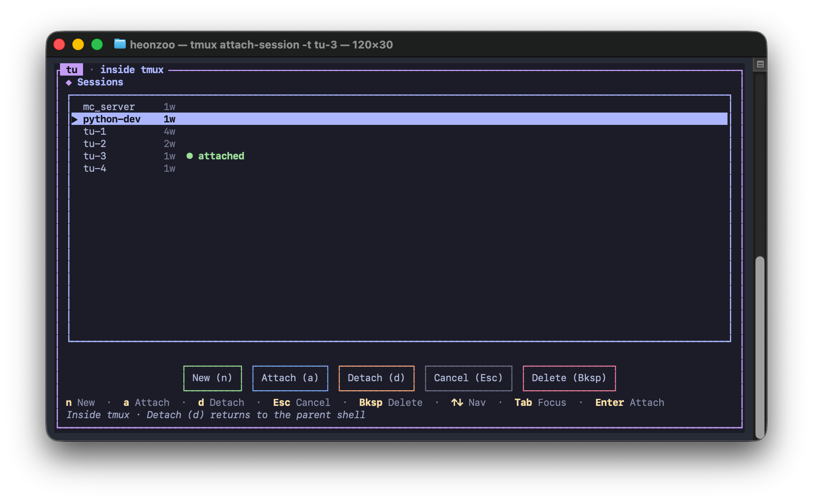

<div align="center">

# `tu`

**A tiny TUI menu on top of `tmux`.**
List, create, attach, detach, or delete sessions — Just type ***tu***

[](https://github.com/hungryZoo/tu/releases/latest)
[](LICENSE)
[](https://github.com/ratatui-org/ratatui)

<br/>

```bash
curl -fsSL https://raw.githubusercontent.com/hungryZoo/tu/main/install.sh | sh
```

[](#6-platform-support)
[](#raspberry-pi-cheat-sheet)<br/>
[](#linux-packages-deb--rpm)
[](#linux-packages-deb--rpm)



</div>

---

`tu` is a single ~2 MB binary that opens a small picker over your
running `tmux` sessions. Pick one to attach, double-click to dive in,
**n** to spawn a fresh session, **d** to detach the current client,
**Backspace** to kill a session (with a confirmation). Run it from a
fresh shell, from a tmux pane (it opens full-screen over your work),
or click the **tu** button it puts on your tmux status bar.

<div align="center">

https://github.com/user-attachments/assets/5b21f9cb-f9f2-415b-bd92-b067b938dbf6

</div>

---

## Table of Contents

1. [Overview](#1-overview)
   - [Features](#features)
   - [How it works](#how-it-works)
2. [Installation](#2-installation)
   - [Quick install (recommended)](#quick-install-recommended)
   - [Homebrew](#homebrew)
   - [crates.io](#cratesio)
   - [Linux packages (.deb / .rpm)](#linux-packages-deb--rpm)
   - [Manual tarball](#manual-tarball)
   - [From source](#from-source)
   - [Verifying downloads](#verifying-downloads)
3. [Quickstart](#3-quickstart)
4. [Usage](#4-usage)
   - [From the parent shell](#from-the-parent-shell)
   - [From a tmux pane](#from-a-tmux-pane)
   - [From the status bar](#from-the-status-bar)
   - [Renaming a session](#renaming-a-session)
   - [Deleting a session](#deleting-a-session)
   - [The button row](#the-button-row)
   - [Window mode and button labels](#window-mode-and-button-labels)
   - [Keyboard & mouse reference](#keyboard--mouse-reference)
5. [Configuration](#5-configuration)
   - [tmux config: one include line, one managed file](#tmux-config-one-include-line-one-managed-file)
   - [Hotkey binding](#hotkey-binding)
   - [Environment variables & flags](#environment-variables--flags)
   - [Update check](#update-check)
6. [Platform support](#6-platform-support)
   - [Release targets](#release-targets)
   - [Raspberry Pi cheat sheet](#raspberry-pi-cheat-sheet)
   - [macOS notes](#macos-notes)
   - [Android (Termux)](#android-termux)
7. [Development](#7-development)
   - [Repository layout](#repository-layout)
   - [Building releases](#building-releases)
   - [Contributing](#contributing)
8. [Roadmap](#8-roadmap)
9. [License](#9-license)

---

## 1. Overview

`tu` is a single binary (under 2 MB) that opens a small picker over
your running `tmux` sessions. Pick one to attach, double-click to
dive in, **n** to spawn a fresh session, **d** to detach the current
client, **Backspace** to kill a session (with a confirmation). Run
it from a fresh shell, from a tmux pane (it opens full-screen over
your work), or click the **tu** button it puts on your tmux status
bar.

### Features

- **Session picker first, everything else second.** No preview,
  no command palette, no plugin system. Just the list.
- **Keyboard and mouse, in equal weight.** Hover lights up
  buttons, single-click selects, double-click attaches; every
  action also has a one-key shortcut.
- **Knows where it is.** Outside tmux, attach/new `execvp`s into
  `tmux attach-session` so you skip the flicker. Inside tmux,
  the same actions use `switch-client`; **Detach** becomes
  available.
- **Popup over your work inside tmux.** Run `tu` from any pane on
  tmux ≥ 3.2 and it re-launches itself in a `display-popup` sized
  60 % of the client, so the panes underneath stay visible and keep
  updating; it hands the pane back when it closes. `--size 100` for
  full screen, `--no-popup` (or `TU_NO_POPUP=1`) for inline.
- **A `tu` button on the status bar.** One click on the bold
  ` tu ` label at the right end of tmux's status line opens the
  same full-screen popup — handy when something is running in
  every pane.
- **Rename in place.** **r** opens a one-field modal prefilled
  with the current name; Enter runs `tmux rename-session`.
- **Safe Delete.** **Backspace** (or forward-Delete) opens a
  confirmation modal with focus on *Back* — an accidental Enter
  cancels. **Esc**, or the `x` in the top-right corner, just closes
  `tu`.
- **One line in your `~/.tmux.conf`.** tu keeps its tmux settings
  (`mouse on`, scrollback, the status-bar button) in a file it owns,
  `~/.config/tu/tmux.conf`, and adds a single `source-file` line to
  yours. Updates to that file are silent and applied live; your own
  lines below the include always win.
- **Quiet update check, one-key update.** Once a day, in the
  background, `tu` asks GitHub for the newest release tag. If it is
  newer than the running binary, the status row shows one line such
  as `v1.2.0 available · brew upgrade tu`. Press **u** or click it and
  `tu` upgrades itself with the method it was installed by (Homebrew,
  cargo, install.sh, `.deb`, `.rpm`), then exits. Nothing waits at
  launch; `TU_NO_UPDATE_CHECK=1` turns it off.
- **Catppuccin Mocha** theme with proper focus, hover, press and
  disabled states across every widget.

### How it works

| Where you run `tu`      | What happens on *Attach* / *New*                     | *Detach*      |
| ----------------------- | ---------------------------------------------------- | ------------- |
| Parent shell (no tmux)  | `tu` exits and `execvp`s `tmux attach-session -t …`  | greyed out    |
| Inside a tmux pane      | opens as a full-screen popup, then `switch-client`    | `detach-client` |
| Status-bar ` tu ` button | same popup as above                                  | `detach-client` |

If a tmux command fails, `tu` stays open and surfaces the actual
error in its status line.

<p align="right"><a href="#table-of-contents">↑ back to top</a></p>

## 2. Installation

> `tmux` must be installed separately — every method below ships
> only the `tu` binary.

### Quick install (recommended)

macOS, Linux and Android (Termux), no sudo. Detects your OS/arch,
downloads the matching release binary, installs it, and makes sure
your shell can find it:

```bash
curl -fsSL https://raw.githubusercontent.com/hungryZoo/tu/main/install.sh | sh
```

**Where it goes, and PATH.** On Termux, tu goes to `$PREFIX/bin`,
which is already on PATH; nothing else is touched. Everywhere else it
goes to `~/.local/bin`. If that directory isn't on your PATH yet, the
installer adds one guarded line to your shell's startup file, chosen
from `$SHELL`, and creates the file if it doesn't exist:

| `$SHELL` | File                                                        |
| -------- | ----------------------------------------------------------- |
| zsh      | `${ZDOTDIR:-~}/.zshrc`                                      |
| bash     | `~/.bashrc` on Linux (plus `~/.bash_profile` if that exists and doesn't source `.bashrc`); `~/.bash_profile` on macOS |
| fish     | `~/.config/fish/conf.d/tu.fish`                              |
| anything else (sh, dash, ksh, …) | `~/.profile`                         |

The line is marked `# Added by tu installer`, only adds the
directory if it isn't on PATH already, and is written once no matter
how often you re-run the installer. Delete it to undo. The current
terminal isn't changed (a script can't do that); the installer prints
the one `export` to run, or open a new terminal.

Useful knobs:

| Variable / flag        | Effect                                        |
| ---------------------- | --------------------------------------------- |
| `TU_VERSION=1.1.6`     | pin a release instead of *latest*             |
| `TU_BIN_DIR=/usr/local/bin` | install somewhere other than the default |
| `--no-modify-path` / `TU_NO_MODIFY_PATH=1` | never touch shell startup files; just print the line to add |
| `sh -s -- --help`      | list every option                             |

### Homebrew

macOS and Linux (Apple Silicon, Intel, x86_64 / aarch64 Linux).
Homebrew picks the right binary for you:

```bash
brew install hungryZoo/tap/tu
```

The formula lives in
[hungryZoo/homebrew-tap](https://github.com/hungryZoo/homebrew-tap).

### crates.io

```bash
cargo install tmux-tu
```

The crate is `tmux-tu` (plain `tu` was taken); the binary is still
`tu`. Requires Rust 1.78+.

### Linux packages (.deb / .rpm)

Optional, needs sudo. The URLs below always resolve to the latest
release.

`.deb` (Debian, Ubuntu, Raspberry Pi OS, …):

```bash
# x86_64
curl -LO https://github.com/hungryZoo/tu/releases/latest/download/tu_amd64.deb
sudo dpkg -i tu_amd64.deb

# ARM64 (Pi 4/5 64-bit OS, AWS Graviton, …)
curl -LO https://github.com/hungryZoo/tu/releases/latest/download/tu_arm64.deb
sudo dpkg -i tu_arm64.deb

# ARMv7 / ARMv6 (32-bit Raspberry Pi OS, any model)
curl -LO https://github.com/hungryZoo/tu/releases/latest/download/tu_armhf.deb
sudo dpkg -i tu_armhf.deb
```

`.rpm` (Fedora, RHEL, CentOS, openSUSE, …):

```bash
# x86_64
sudo rpm -i https://github.com/hungryZoo/tu/releases/latest/download/tu-x86_64.rpm

# ARM64
sudo rpm -i https://github.com/hungryZoo/tu/releases/latest/download/tu-aarch64.rpm
```

### Manual tarball

Grab the archive matching your platform from the
[latest release](https://github.com/hungryZoo/tu/releases/latest)
(see [Release targets](#release-targets) for the list), unpack it,
and copy the binary somewhere on `PATH`:

```bash
tar -xzf tu-<version>-<triple>.tar.gz
mkdir -p ~/.local/bin
install -m 0755 tu ~/.local/bin/tu
```

### From source

```bash
git clone https://github.com/hungryZoo/tu.git
cd tu
cargo install --path .
```

That drops `tu` into `~/.cargo/bin`. Requires Rust 1.78+;
`cargo test` runs ~50 unit tests.

### Verifying downloads

Every release ships a `SHA256SUMS` file. After downloading any
asset, run:

```bash
shasum -a 256 -c SHA256SUMS --ignore-missing
```

<p align="right"><a href="#table-of-contents">↑ back to top</a></p>

## 3. Quickstart

Just run it. `tu` figures out whether you're inside tmux:

```bash
tu
```

- **Outside tmux** → pick a session (or create one) and the shell
  hands itself over to `tmux attach-session`.
- **Inside tmux** → `tu` opens full-screen in a popup over the
  current client. Pick a session (`switch-client`) or press
  **d** / click **Detach** to return to the parent shell.
- **From the status bar** → click the ` tu ` button at the right
  end of the bar (added on first launch, see
  [Configuration](#5-configuration)).

On first launch `tu` offers to add a few lines to `~/.tmux.conf`
(mouse support, a bigger scrollback, the status-bar button). Say
yes, restart `tu` once, and you're set.

<p align="right"><a href="#table-of-contents">↑ back to top</a></p>

## 4. Usage

`tu` behaves a little differently depending on whether you
launched it from your parent shell or from inside a tmux pane.

### From the parent shell

1. Run `tu` — the menu opens in the parent shell.
2. Pick a session with ↑/↓ + **Enter** (or double-click a row,
   or click **Attach**) → `tu` closes and the parent shell
   `execvp`s into `tmux attach-session -t <name>`. Detaching
   from tmux later lands you back at the parent shell, not
   at `tu`.
3. **n** / **New** creates a fresh `tu-N` session and attaches
   to it via the same hand-off.
4. **Esc** (or the `x` in the top-right corner) just closes `tu`.

**Detach** is greyed out: there is no tmux client to detach.

### From a tmux pane

1. Run `tu` inside a tmux pane. On tmux ≥ 3.2 the pane instance
   asks the server for `display-popup -E -w 100% -h 100%` (plus
   `-B` on ≥ 3.3) running the same binary, and waits for the
   popup to close. Older tmux draws inline in the pane.
2. Pick / create works the same, except the existing client is
   moved with `tmux switch-client -t <name>`.
3. **d** / **Detach** runs `tmux detach-client` so the current
   client detaches and you land back at the parent shell — and
   `tu` closes too.

The popup instance knows it is a popup because tmux exports
`$TMUX` but no `$TMUX_PANE` to it, so it never opens a second
popup — which also means your own `display-popup ... tu` bindings
keep working unchanged.

### From the status bar

The `~/.tmux.conf` block in [Configuration](#the-tmuxconf-baseline)
draws a bold ` tu ` label at the right end of the status line and
binds a left click on it to the same full-screen popup. Clicks
anywhere else on the bar keep tmux's default (select the window
under the pointer).

### Renaming a session

Highlight a row and press **r** (or click **Rename**). A small
modal opens with the current name already in the field, so a tweak
is a few keystrokes:

- type to append, **Backspace** to erase, **Ctrl+U** to clear;
- **Enter** runs `tmux rename-session -t <old> <new>` and keeps the
  renamed session highlighted;
- **Esc** cancels.

Names follow tmux's rules: non-empty, no leading or trailing
spaces, and no `:` or `.` (both are target separators). The hint
line under the field says what is wrong while you type, and a name
that already exists is refused before tmux is called.

### Deleting a session

Hard-deletes are gated by a confirmation modal so a single
keystroke can't nuke anything.

1. Highlight a row, press **Backspace** (or forward-Delete, or
   click the red **Delete** button).
2. *"Really delete session 'X'? This cannot be undone."* opens
   with focus on **Back** — Enter cancels by default.
3. Tab to **Delete**, hit Enter (or click it). On confirm, `tu`
   runs `tmux kill-session -t <name>` and refreshes the list.

> On Mac keyboards the key labelled *delete* is Backspace, which
> is exactly what `tu` listens for. **fn + delete** works too.

### The button row

Five buttons in one row — **Attach · New · Rename · Delete · Detach**
— plus a red `x` close chip in the window's top-right corner.
**Attach** has focus by default, so ↑/↓ then Enter means "pick a
session, attach"; ↑/↓ always put focus back on Attach. **Tab**,
**Shift+Tab**, ← and → walk the row and the `x`.

### Window mode and button labels

What you see is decided on two axes. Each has fixed names, used the
same way in the code (`WindowMode`, `LabelTier`), here and in the
release notes.

**Window mode** — how much of the terminal the window takes:

| Name           | Code                  | What                                                         |
| -------------- | --------------------- | ------------------------------------------------------------ |
| reduced window | `WindowMode::Reduced` | the requested size (`--size`, default 60 %), centred; a popup over the live panes inside tmux |
| full window    | `WindowMode::Full`    | the whole terminal or tmux client                            |

**Button labels** — what is written inside each button (the shortcut
is always yellow):

| Name     | Code                 | Looks like                   | Row width |
| -------- | -------------------- | ---------------------------- | --------- |
| full     | `LabelTier::Full`    | `Attach (a)` … `Detach (d)`  | 74 cells  |
| word     | `LabelTier::Word`    | `Attach` … `Delete Bksp` (initial highlighted) | 56 cells |
| key box  | `LabelTier::KeyBox`  | bordered `A` `N` `R` `Bksp` `D` | 32 cells |
| key only | `LabelTier::KeyOnly` | bare keys in each button's colour; focus and hover still fill the cell | 22 cells |

**Stages at the default size.** As the terminal shrinks, tu walks
down these five stages, and labels only ever get shorter:

| Stage | Terminal                     | Window mode    | Labels   |
| ----- | ---------------------------- | -------------- | -------- |
| 1     | ≥ 129 columns, ≥ 22 rows     | reduced window | full     |
| 2     | 99-128 columns, ≥ 22 rows    | reduced window | word     |
| 3     | 60-98 columns (or < 22 rows) | full window    | word     |
| 4     | 36-59 columns                | full window    | key box  |
| 5     | ≤ 35 columns                 | full window    | key only |

The reduced window is kept only while it fits word labels and four
list rows. When tu has to fall back to the full window, labels stay
at word or shorter, so an 80-column editor panel shows `Attach`, the
same as a 120-column terminal, not `Attach (a)`. (A wide but short
terminal, e.g. 200 × 20, is the exception: the width alone would have
fitted full labels, so it keeps them.) Asking for `--size 100`
explicitly lifts the cap: an 80-column terminal then shows full
labels.

The same rule runs in three places: outside tmux on every frame (so
resizing switches live), when `tu` is launched from a pane (checked
against the tmux client before the popup opens), and in the
status-bar binding (written into the managed tmux file as a
`#{client_width}` / `#{client_height}` condition).

### Keyboard & mouse reference

| Key                         | Action                                   |
| --------------------------- | ---------------------------------------- |
| ↑ / ↓, wheel                | move selection                           |
| **Home** / **End**          | jump to first / last session             |
| **Enter** / **a**           | attach / switch to the selected session  |
| **n**                       | new session                              |
| **r**                       | rename selected session                  |
| **u**                       | update `tu` (when the status row says a newer release exists) |
| **d**                       | detach current client (inside tmux only) |
| **Backspace** / **Delete**  | delete selected session (with confirm)   |
| **Tab** / **Shift+Tab**, ← / → | move focus along the buttons and the `x` |
| **Esc** / **Ctrl+C**, `x`   | close `tu`                               |

Mouse handling uses the full crossterm event stream, including
motion:

- **Hover** — buttons brighten, list rows tint subtly.
- **Press / release** — mousedown latches the *pressed* style;
  release on the same widget fires the action, release off
  cancels.
- **Click-to-focus** — clicking a button also moves keyboard
  focus there.
- **Single vs. double click on the list** — a single click
  selects a row without attaching; a double click within
  ~450 ms on the same row attaches.
- **Wheel** — scrolling moves the selection in the session
  list regardless of where the cursor lives.

Modern terminals (iTerm2, Alacritty, kitty, recent Apple
Terminal / gnome-terminal) report motion events by default;
inside tmux, the `set -g mouse on` baseline below is what gets
them forwarded.

<p align="right"><a href="#table-of-contents">↑ back to top</a></p>

## 5. Configuration

### tmux config: one include line, one managed file

`tu` keeps its tmux settings in a file it owns and asks `~/.tmux.conf`
to source it:

| File                      | Owner | Contents                                                   |
| ------------------------- | ----- | ---------------------------------------------------------- |
| `~/.config/tu/tmux.conf`  | tu    | `mouse on`, `history-limit`, the status-bar ` tu ` button and its click binding. Regenerated whenever tu's template changes; a version comment sits on line 1 |
| `~/.tmux.conf`            | you   | gets exactly one line from tu: `source-file -q ~/.config/tu/tmux.conf  # Added by tu`. Nothing else in it is ever touched |

(`$XDG_CONFIG_HOME/tu/tmux.conf` if `XDG_CONFIG_HOME` is set.)

**Overriding tu.** tmux keeps the last value it reads, so put your own
settings *below* the `source-file` line and they win — `set -g mouse
off`, a different `status-right-length`, your own binding for
`MouseDown1Status`, anything. tu never edits those lines.

**On every launch** tu decides one of four things:

| Situation                                              | What happens                                                                 |
| ------------------------------------------------------ | ---------------------------------------------------------------------------- |
| no `source-file` line yet                              | a modal asks once; **Yes** adds the line and writes the managed file         |
| a 1.1.x `# Added by tu … # End of tu` block is present | a modal asks once; **Yes** replaces that block, in place, with the one line (edits you made *inside* the block are dropped) |
| line present, managed file missing or older template   | the managed file is rewritten and re-sourced silently; the status row says `tmux config refreshed (vN)` |
| everything current                                     | nothing                                                                      |

Changes are applied to the running tmux server as well (`tmux
source-file`), so there is no restart to wait for. The managed file is
safe to source repeatedly: the status-bar fragment is appended only
when `status-right` doesn't already carry it.

The managed file, on tmux ≥ 3.3:

```tmux
# tu managed tmux config v1 — generated by tu; edits here are overwritten.
# Override anything by setting it in ~/.tmux.conf *below* the source-file line.
set -g mouse on
set -g history-limit 10000000
set -g status-right-length 60
if -F '#{m:*range=user|tu*,#{status-right}}' '' 'set -ag status-right "#[range=user|tu]#[fg=#1e1e2e,bg=#cba6f7,bold] tu #[norange]#[default]"'
bind -T root MouseDown1Status if -F '#{==:#{mouse_status_range},tu}' 'display-popup -E -B -w 60% -h 60% tu' 'select-window -t ='
```

`-B` is written only on tmux ≥ 3.3; on 3.2 the popup keeps its
border. Below 3.2 the button and binding are left out and only the
two `set` lines are written.

The bind runs plain `tu`, resolved through the tmux server's
`PATH`. If you installed to `~/.local/bin` and tmux was started
from a shell that doesn't put it on `PATH`, add a line below the
include with the absolute path.

### Hotkey binding

Optional — bind a key so `F12` opens the same popup from any pane:

```tmux
bind-key -n F12 display-popup -E -B -w 100% -h 100% "tu"
```

(`-B` needs tmux ≥ 3.3; drop it on 3.2.)

### Environment variables & flags

| Name              | Effect                                                  |
| ----------------- | ------------------------------------------------------- |
| `--no-popup`      | inside tmux, draw inline in the pane instead of a popup |
| `TU_NO_POPUP=1`   | same as `--no-popup`                                    |
| `TU_NO_UPDATE_CHECK=1` | never check GitHub for a newer release, never show the note |
| `--check-update`  | check GitHub right now, print the result, exit (0 up to date, 10 update available, 11 unreachable) |
| `--update`        | check now and, if newer, upgrade in place with the detected install method (0 done or up to date, 1 upgrade failed, 11 unreachable) |
| `--size PCT` / `TU_SIZE` | window size, 10-100 (default 60): the tmux popup size, or a centred window outside tmux. 100 = full screen. On a small terminal tu uses the full window anyway (see *Window mode and button labels*) |
| `--version`       | print the version and exit                              |
| `--help`          | list every flag                                         |

### Update check

`tu` keeps a tiny file with the time of the last check and the
newest tag it saw:

| Platform | Cache file                                                    |
| -------- | ------------------------------------------------------------- |
| Linux    | `~/.cache/tu/update-check` (`$XDG_CACHE_HOME/tu/update-check` if set) |
| macOS    | `~/Library/Caches/tu/update-check`                            |

On launch:

1. If the file is less than 24 hours old, nothing happens.
2. Otherwise the timestamp is written first, then a background
   thread runs `curl` against `github.com/hungryZoo/tu/releases/latest`
   with a two-second limit and stores the redirect's tag. The UI never
   waits for it; a result shows up on the *next* launch.
3. If the stored tag is newer than the running binary, the status
   row shows `vX.Y.Z available · <how to upgrade>`. The hint is
   `brew upgrade tu`, `cargo install tmux-tu`, `press u or click to
   update` (install.sh), the `.deb` / `.rpm` command, or the releases
   URL, chosen from the binary's path.
4. Press **u** or click the note to open the **Update** modal. It
   names the install method it detected and the exact command it
   will run. **Enter** closes `tu`, runs that command with the
   terminal attached (so `sudo` can ask for a password), and exits;
   the next `tu` is the new version. **Esc** keeps the note for later.

| Install method | Detected by | Command run |
| --- | --- | --- |
| Homebrew | path contains `/Cellar/`, `/homebrew/`, `/linuxbrew/` | `brew upgrade tu` |
| cargo | `~/.cargo/bin/tu` | `cargo install tmux-tu` |
| install.sh / tarball | any other path under `$HOME`, or `$PREFIX/bin` on Termux | `curl … install.sh \| sh -s -- --bin-dir <that dir>` |
| `.deb` | `/usr/bin/tu` with a dpkg database | download `tu_<arch>.deb`, `sudo dpkg -i` |
| `.rpm` | `/usr/bin/tu` with an rpm database | `sudo rpm -U …/tu-<arch>.rpm` |
| unknown | anything else | nothing; the modal shows the releases URL |

`tu --update` does the same from the command line: checks now, and
if a newer release exists runs the matching command.

Failures (offline, no `curl`, rate limits) are silent and retried a
day later. `tu --check-update` runs the same check immediately,
prints the verdict and the upgrade hint, refreshes the cache, and
exits with 0 (up to date), 10 (update available) or 11 (unreachable),
so it also works from scripts. The note never covers an error message
or an action result; the status row is otherwise empty, so the note
has the row to itself on narrow terminals.

<p align="right"><a href="#table-of-contents">↑ back to top</a></p>

## 6. Platform support

`tu` runs anywhere `tmux` runs: Linux, macOS, and the BSDs. On
Windows use WSL. Release binaries are built for the targets below.

### Release targets

| Triple                          | Use it for                                      |
| ------------------------------- | ----------------------------------------------- |
| `aarch64-apple-darwin`          | macOS, Apple Silicon (M1/M2/M3/M4)              |
| `x86_64-apple-darwin`           | macOS, Intel                                    |
| `x86_64-unknown-linux-gnu`      | Linux x86_64, dynamic glibc                     |
| `x86_64-unknown-linux-musl`     | Linux x86_64, fully static                      |
| `aarch64-unknown-linux-gnu`     | Linux ARM64 (Raspberry Pi 3/4/5 in 64-bit OS)   |
| `aarch64-unknown-linux-musl`    | Linux ARM64, fully static                       |
| `armv7-unknown-linux-gnueabihf` | 32-bit ARMv7 boards (Pi 2 and up on 32-bit OS)  |
| `arm-unknown-linux-gnueabihf`   | 32-bit ARMv6: Raspberry Pi 1, Zero, Zero W      |

`musl` builds are statically linked and need nothing on the host;
`gnu` builds are smaller but require glibc ≥ 2.17.

### Raspberry Pi cheat sheet

Which asset you need depends on the SoC *and* on whether you run a
64-bit or 32-bit Raspberry Pi OS. The `armhf` `.deb` is built from
the ARMv6 binary, so it installs on every 32-bit Pi OS.

| Model                                   | SoC     | CPU                    | 64-bit OS                        | 32-bit OS                                          |
| --------------------------------------- | ------- | ---------------------- | -------------------------------- | -------------------------------------------------- |
| Pi 1 A/B/A+/B+, Zero, Zero W            | BCM2835 | ARM1176 (ARMv6)        | not available                    | `arm-unknown-linux-gnueabihf` / `armhf.deb`       |
| Pi 2 B v1.1                             | BCM2836 | Cortex-A7 (ARMv7)      | not available                    | `armv7-unknown-linux-gnueabihf` / `armhf.deb`     |
| Pi 2 B v1.2, Pi 3 B/B+/A+, Zero 2 W     | BCM2837 | Cortex-A53 (ARMv8)     | `aarch64-*` / `arm64.deb`        | `armv7-unknown-linux-gnueabihf` / `armhf.deb`     |
| Pi 4 B, Pi 400, CM4                     | BCM2711 | Cortex-A72 (ARMv8)     | `aarch64-*` / `arm64.deb`        | `armv7-unknown-linux-gnueabihf` / `armhf.deb`     |
| Pi 5, Pi 500, CM5                       | BCM2712 | Cortex-A76 (ARMv8.2)   | `aarch64-*` / `arm64.deb`        | `armv7-unknown-linux-gnueabihf` / `armhf.deb`     |

`install.sh` picks the right one from `uname -m` (`aarch64`,
`armv7l`, `armv6l`). A 32-bit Pi OS image on a Pi 4/5 boots a
64-bit kernel, so `uname -m` reports `aarch64` there and the
installer hands you the static `aarch64-unknown-linux-musl` build,
which runs fine on that setup.

### macOS notes

Binaries installed via `install.sh`, Homebrew, or `cargo` run as-is.
If you download a tarball **with a browser**, macOS attaches a
quarantine flag and Gatekeeper will refuse to run the unsigned
binary; clear it once:

```bash
xattr -d com.apple.quarantine ~/.local/bin/tu
```

### Android (Termux)

```bash
pkg install tmux curl
curl -fsSL https://raw.githubusercontent.com/hungryZoo/tu/main/install.sh | sh
tu
```

- The installer puts `tu` in `$PREFIX/bin`, which Termux already has
  on PATH, so no startup file is created (Termux ships without a
  `~/.bashrc`).
- 64-bit Termux (`uname -m` = `aarch64`, or `x86_64` on emulators)
  uses the static `musl` build. There is no 32-bit ARM build for
  Android yet; the installer says so instead of installing a binary
  that can't run.
- **u** updates in place by re-running the installer into
  `$PREFIX/bin`.

<p align="right"><a href="#table-of-contents">↑ back to top</a></p>

## 7. Development

### Repository layout

```
src/
├── lib.rs          # crate root for unit tests
├── main.rs         # binary entry point (clap, popup re-launch, execvp hand-off)
├── models.rs       # Session struct + tab-delimited parser
├── tmux.rs         # thin wrapper over the `tmux` CLI
├── conf_setup.rs   # ~/.tmux.conf directives + status-bar button
├── state.rs        # AppState, Screen, Focus, ButtonId, hit-test
├── theme.rs        # Catppuccin Mocha palette + per-state styles
├── update.rs       # once-a-day release check + status-row note
├── view.rs         # render(): pure ratatui draw functions
└── app.rs          # crossterm event loop + action dispatch
```

### Naming

| What                      | Name      | Defined in                       |
| ------------------------- | --------- | -------------------------------- |
| crates.io crate           | `tmux-tu` | `Cargo.toml` `[package].name`    |
| executable                | `tu`      | `Cargo.toml` `[[bin]].name`      |
| `.deb` / `.rpm` package   | `tu`      | `Cargo.toml` `[package.metadata.*].name` |
| release asset prefix      | `tu`      | follows the executable           |

Plain `tu` was already taken on crates.io, so only the crate
identifier carries the long name. Every script reads these from
`Cargo.toml` through `scripts/meta.sh`; nothing else hard-codes a
name, so a rename is a one-file change.

### Continuous integration

[`ci`](.github/workflows/ci.yml) runs on every push and pull
request: `cargo fmt --check`, `cargo clippy -D warnings`,
`cargo test`, then a real `scripts/package-all.sh` pass on the native
target that asserts the tarball, `.deb`, `.rpm` and their version-less
aliases exist with the expected names. Anything that would break a
release fails here first.

### Building releases

#### From GitHub Actions (the normal path)

The [`release`](.github/workflows/release.yml) workflow does the
whole thing on one Ubuntu runner: cross-builds all eight targets
with `cargo-zigbuild` (macOS included), packages tarballs +
`.deb` + `.rpm` + `SHA256SUMS`, and publishes the GitHub release.
The tag is created only after the build and packaging succeed, so a
failed run never leaves a tag without a release.

The same run then rewrites `Formula/tu.rb` in
[hungryZoo/homebrew-tap](https://github.com/hungryZoo/homebrew-tap)
to the new checksums and pushes it (repository secret
`HOMEBREW_TAP_TOKEN`), and publishes the crate with `cargo publish`
(secret `CARGO_REGISTRY_TOKEN`). Either step is skipped with a
warning if its secret is missing; `scripts/post-release.sh` does
both by hand from a machine with `gh` and `cargo login`.

To cut a release:

1. Bump `version` in `Cargo.toml`, add
   `.github/release-notes/vX.Y.Z.md` (the first `# heading` becomes
   the release title), merge to `main`.
2. Either push a tag — `git tag vX.Y.Z && git push origin vX.Y.Z` —
   or open *Actions → release → Run workflow* on `main`, which builds
   first and then creates the tag for you. Re-running it for a version
   that already has a release rebuilds that tag's commit and replaces
   the assets.

The workflow refuses a tag whose version doesn't match `Cargo.toml`.

#### Locally (macOS)

Cross-compiling to Linux from macOS uses
[`cargo-zigbuild`](https://github.com/rust-cross/cargo-zigbuild)
with `zig` as the C linker, so no Docker / Linux toolchain is
required.

One-time toolchain setup:

```bash
brew install zig
cargo install --locked cargo-zigbuild cargo-deb cargo-generate-rpm
rustup target add \
  aarch64-apple-darwin x86_64-apple-darwin \
  x86_64-unknown-linux-gnu x86_64-unknown-linux-musl \
  aarch64-unknown-linux-gnu aarch64-unknown-linux-musl \
  armv7-unknown-linux-gnueabihf arm-unknown-linux-gnueabihf
```

Build every binary, then package tarballs + `.deb` + `.rpm` +
`SHA256SUMS` into `dist/`:

```bash
bash scripts/build-all.sh
bash scripts/package-all.sh          # version comes from Cargo.toml
scripts/update-formula.sh <version> dist/SHA256SUMS   # refresh the tap
```

### Contributing

1. Fork, branch, commit with a conventional-commits prefix
   (`feat:`, `fix:`, `chore:`).
2. Run `cargo fmt`, `cargo clippy --all-targets -- -D warnings`,
   and `cargo test` before pushing.
3. Open a PR against `main`. Small, scoped PRs are far easier
   to land.

The Python prototype (Textual) is preserved at tag
[`v0.9.0`](https://github.com/hungryZoo/tu/releases/tag/v0.9.0)
(`git checkout v0.9.0`). It's frozen; all development happens in the
Rust tree.

<p align="right"><a href="#table-of-contents">↑ back to top</a></p>

## 8. Roadmap

- [x] Formula lives in the shared tap repo (`hungryZoo/homebrew-tap`).
- [x] Version-less `.deb` / `.rpm` download URLs.
- [ ] Bottles per platform.
- [ ] AUR + Arch Linux packaging.
- [ ] Self-hosted apt repo on GitHub Pages so `apt install tu`
      works on Debian / Raspberry Pi OS.

PRs welcome — see [Contributing](#contributing).

## 9. License

[MIT](LICENSE) © hungryZoo

<p align="right"><a href="#table-of-contents">↑ back to top</a></p>
